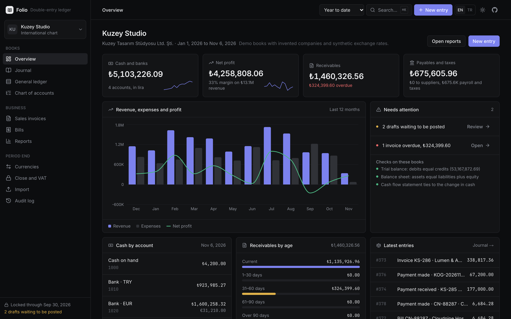
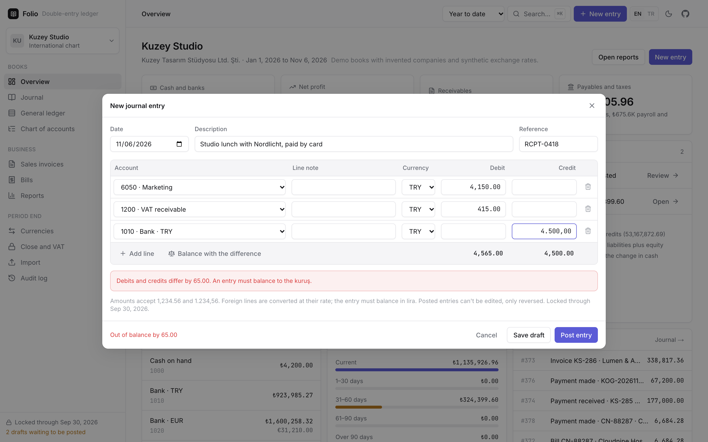
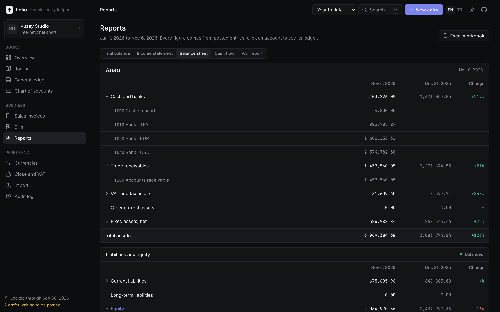
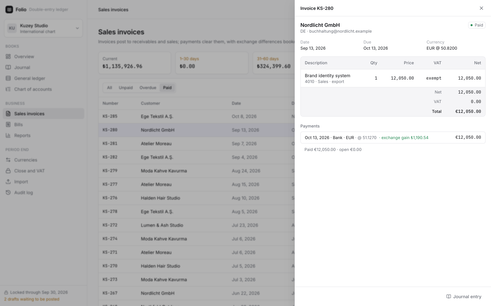
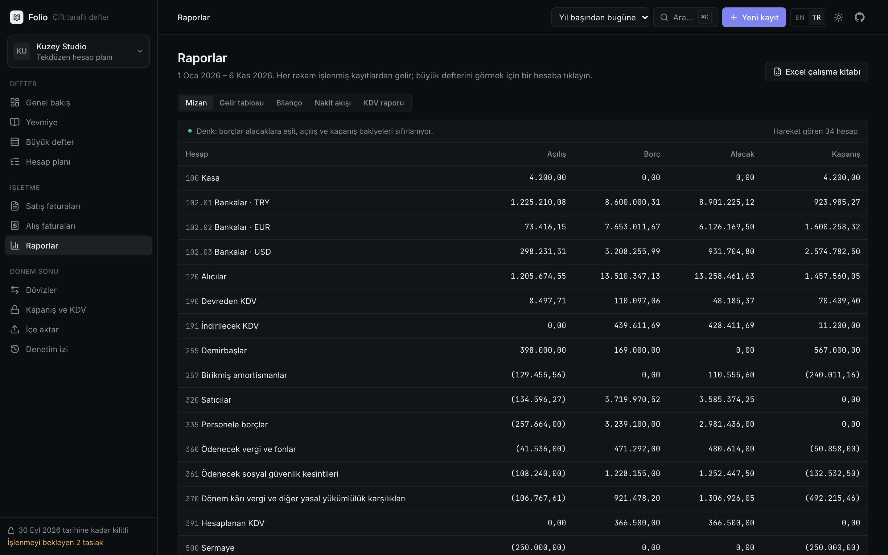
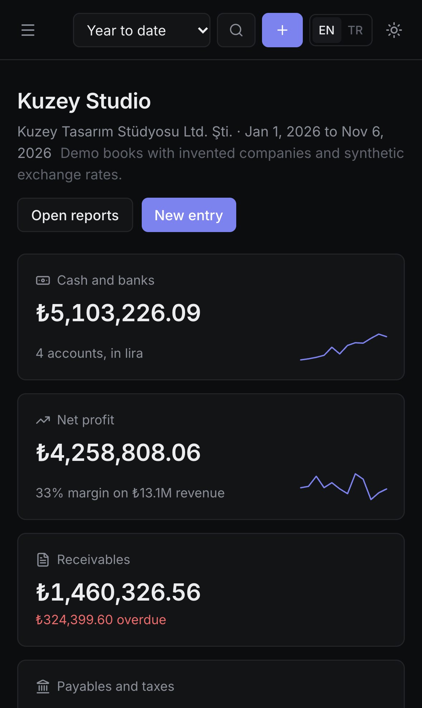

# Folio

**Double-entry bookkeeping that runs in your browser.** It includes:
- the journal, general ledger, trial balance and financial statements;
- invoices and bills;
- VAT, multi-currency revaluation and the year-end close.

Books can be kept in the international chart of accounts or in the Turkish uniform chart (Tekdüzen Hesap Planı). There is no server and no account; the books stay in your browser.

**[Live demo](https://ozenyunus35.github.io/double-entry-ledger/)** · The demo shows twelve months of books for Kuzey Studio, a fictional Istanbul design studio with clients in the US, Germany, France and Türkiye. All companies are invented and the exchange rates are synthetic.



## What it does

**The ledger**
- **Every entry balances to the kuruş.**
  - Amounts are stored as integer minor units, so no total is ever off by 0.01.
  - Posting checks that:
    - debits equal credits;
    - accounts exist and aren't headings or archived;
    - dates are real calendar days;
    - amounts are positive, with two decimals;
    - foreign lines carry a rate that converts to their lira amount.
- **Drafts, then posting.** Drafts can be unbalanced and edited freely. Posting runs the rules, assigns the next journal number and freezes the entry.
- **Corrections the way auditors expect.** A posted entry is never edited or deleted. It is reversed with a mirror entry that links both ways.
- **Period lock.** Nothing can be posted, edited or reversed on or before the lock date. A closed year can't be unlocked.
- **Audit log.** Every draft, post, reversal, lock, import, payment and close is logged.

**Two charts of accounts**
- **International:** 1000 Cash to 8000 Income tax.
- **Turkish uniform chart:** 100 Kasa, 102.01 Bankalar TRY, 120 Alıcılar, 191 İndirilecek KDV, 391 Hesaplanan KDV, 590 Dönem net kârı, 770.02 Kira giderleri and so on.
- Accounts carry a role (bank, receivables, output VAT…). The engine, reports and demo data work the same in either chart, and a test builds the demo books in both and compares the results.
- You can add your own accounts and sub-accounts, and archive the ones you don't use.

**Business documents**
- **Sales invoices and supplier bills** post their journal entry when issued. The entry has one line per income or expense account, plus VAT.
- **Payments** clear invoices and bills, in full or in part.
- **Foreign currency.**
  - In a foreign currency, the receivable is cleared at the rate it is carried at, and the difference to the payment day's rate is a realised exchange gain or loss.
  - Month-end revaluation restates open euro and dollar balances (banks, receivables, payables) at the closing rate and books the unrealised difference.
- **Aging** of receivables and payables: current, 1–30, 31–60, 61–90 and over 90 days, in lira at today's rate.

**Period end**
- **VAT.** The month's output VAT is set against input VAT and last month's carry-forward. Settlement leaves either VAT to pay (taxes payable) or a new carry-forward (devreden KDV). The report also splits sales and purchases by rate for the declaration.
- **Recurring entries**, such as monthly depreciation, run from templates. Months inside a locked period are skipped and reported.
- **Year-end close.**
  - Income and expense accounts are closed into the year's result.
  - The result is carried to retained earnings (or accumulated losses) on 1 January.
  - The year is locked.
  - Years must be closed in order.

**Reports**
- **Trial balance** with opening balance, period movements and closing balance. The totals always net to zero.
- **Income statement** compared with the previous period of the same length, with each line drilling down to its accounts.
- **Balance sheet** compared with the last year end. Profit not yet closed into retained earnings is shown on its own line, so assets always equal liabilities plus equity.
- **Cash flow statement**, indirect method. The effect of exchange rates on foreign cash is shown apart, and the statement ties to the change in cash.
- **Excel workbook** with journal, trial balance, income statement, balance sheet, cash flow, receivables aging and the chart of accounts. Headers follow the interface language, with frozen header rows, filters and number formats. The journal also exports as CSV.

**Import**
- **Journal CSV.**
  - Formats it reads:
    - English or Turkish headers (Date/Tarih, Account/Hesap, Debit/Borç, Credit/Alacak, Entry/Fiş No…);
    - comma, semicolon or tab delimiters;
    - UTF-8 or Windows-1254 text from Turkish Excel;
    - `1,234.56`, `1.234,56`, `(500.00)`, `12,50 TL` and similar amounts;
    - day-first, month-first, `31 Oca 2026` and Excel serial dates.
  - Accounts match by code (`102.01`, `10201`) or by name. Without an entry column, lines are grouped until they balance.
  - Every entry passes the same rules as one typed by hand. The preview says, row by row, why an entry can't be posted, and only the good ones are posted.
- **Bank statement CSV.**
  - Each line gets a suggested other side:
    - an open invoice or bill it pays exactly;
    - otherwise an account matched from description words, with Turkish suffixes handled (*kirası*, *faizi*, *EFT ücreti*).
  - Lines already imported are skipped.
- Excel, PDF and binary files are refused with a clear reason.

**Everywhere**
- An English and Turkish interface, including every rule message, report line and description the app writes. Dates, numbers and percentages follow the language (1,234.56 / 1.234,56, 12% / %12).
- A ⌘K command palette that searches pages, accounts, entries, invoices and companies. `N` opens a new entry.
- Links to every screen, such as `?v=ledger&a=102.01`, `?v=journal&e=…` and `?v=sales&d=…`.
- Several companies in one browser, each with its own chart.
- Light and dark themes and a phone layout.

| Journal entry | Balance sheet |
| --- | --- |
|  |  |
| **Invoice with an exchange gain** | **In Turkish (Tekdüzen)** |
|  |  |

<p align="center"></p>

## How it is built

- Next.js 16 (static export), React 19, TypeScript and Tailwind CSS 4. Recharts draws the charts and ExcelJS writes the workbook, loaded only when you export.
- `src/lib` is the ledger engine and has no UI code:

  | File | What it does |
  | --- | --- |
  | `money.ts` | integer amounts and parsing |
  | `charts.ts` | both charts and their roles |
  | `ledger.ts` | posting rules, reversal, lock and balances |
  | `fx.ts` | rates, carried rates and revaluation |
  | `docs.ts` | invoices, bills, payments and aging |
  | `close.ts` | VAT and year-end |
  | `reports.ts` | the statements |
  | `importer.ts` | CSV reading |
  | `seed.ts` | the demo year |

- **The demo books are built by the engine itself.** `seed.ts` issues invoices, records payments, runs payroll, revalues, settles VAT and closes the year through the same functions the interface calls. The demo data therefore passes every rule a user's entries must pass.
- **Built around today.** The books are rebuilt each day so their twelve months end today; ids are sequential, so shared links keep working. Once you change a demo book, your copy is kept in localStorage.

## Tests

- **Unit tests (Vitest), 112.** They cover:
  - posting rules and the lock;
  - reversal, invoices, payments, realised and unrealised exchange differences;
  - VAT settlement and carry-forward;
  - the year-end close;
  - money parsing in both styles;
  - Turkish and English dates;
  - CSV parsing with quotes, tabs and Windows-1254;
  - an adversarial import file where every entry has a different problem, and 200 random junk files that must not throw.
- **Checks on the demo books, in both charts:**
  - every entry balances;
  - the trial balance nets to zero for any period;
  - the balance sheet balances at every month end;
  - the cash flow statement ties out;
  - no bank account goes below zero.
- **Translation tests.** Every `t()` literal, every rule message, every label table and every description in the demo books has a Turkish translation.
- **End-to-end tests (Playwright)** on desktop Chrome, desktop Safari, iPhone and Android:
  - posting with Turkish number input, and refusing an unbalanced entry;
  - the period lock and reversal;
  - a euro invoice paid at a better rate;
  - imports, and a file that is not CSV;
  - the reports and the Excel download;
  - the command palette and links;
  - switching charts;
  - every screen in Turkish with no untranslated text.

```bash
npm install
npm run dev          # http://localhost:3000
npm test             # unit tests
npm run build && npm run test:e2e
```

## Limits

- It is a bookkeeping demo, not certified accounting software. It doesn't produce e-Defter or e-Fatura XML, file declarations or connect to a bank.
- Exchange rates in the demo are synthetic. Enter the central bank's rates for real books.
- Books live in this browser's storage. Export the workbook to keep a copy.

Built by [Yunus Ozen](https://ozenyunus35.github.io/yunus-ozen-portfolio/). MIT licence.
